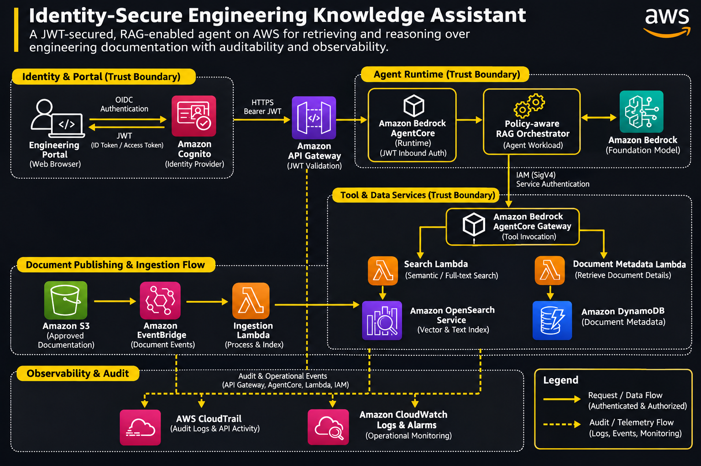

# Building an Identity-Secure AI Knowledge Assistant on AWS

**An independent engineering reference implementation**

## 1. Introduction

AI agents increasingly interact with internal documents, APIs, databases, and business systems. This introduces an important engineering challenge: an agent must not only produce useful answers but also establish who is invoking it, what resources it can access, and which actions it is permitted to perform.

This tutorial explores an identity-secure engineering knowledge assistant built around Amazon Bedrock AgentCore and supporting AWS services.

The application allows authenticated engineering employees to:
- Search approved engineering documentation.
- Retrieve relevant technical references.
- Ask questions using retrieval-augmented generation (RAG).
- Access authorized document metadata.
- Maintain traceable records of agent and tool activity.

The architecture uses separate security boundaries for human users, agent workloads, and backend services.

### Learning objectives

By completing this tutorial, you should understand:

1. JWT-based authentication and OAuth 2.0.
2. AWS IAM and SigV4 authentication.
3. Agent workload identity.
4. Least-privilege permissions and ABAC.
5. Secure agent-to-tool communication.
6. RAG ingestion and retrieval.
7. Cloud audit logging and operational monitoring.
8. Security testing and cost optimization.

## 2. Prerequisites

Recommended knowledge and tooling:

| Requirement | Purpose |
|---|---|
| AWS account | Cloud infrastructure |
| Python 3.11+ | Backend implementation |
| AWS CLI | Resource management |
| boto3 | AWS service integration |
| Amazon Cognito | User authentication |
| Amazon Bedrock | Foundation model access |
| Amazon Bedrock AgentCore | Agent hosting and identity |
| Amazon S3 | Document storage |
| Amazon OpenSearch Service | Search and retrieval |
| Amazon DynamoDB | Document metadata |
| AWS CloudTrail | Audit events |
| Amazon CloudWatch | Logs, metrics, and alarms |

Additional knowledge of HTTP, REST APIs, JSON, IAM policies, and OAuth 2.0 is recommended.

## 3. Reference architecture

### Architecture diagram



### 3.1 Application flow

The system has four logical layers.

**Layer 1 — Identity and user access**

An engineering employee accesses a web portal and authenticates through Amazon Cognito. The application obtains an OAuth/OIDC token and presents it when requesting access to the agent.

**Layer 2 — Agent execution**

Amazon Bedrock AgentCore Runtime validates the incoming JWT using the configured identity provider metadata and authorization rules.

After authentication, the agent:
- Interprets the question.
- Determines which retrieval operations are needed.
- Applies application-level authorization checks.
- Uses the foundation model to construct a grounded response.

**Layer 3 — Tools and data**

The agent accesses approved tools through an AgentCore Gateway using IAM-based service authentication.

The tools include:
- A search function backed by OpenSearch.
- A metadata lookup function backed by DynamoDB.

Documents enter the system through an independent ingestion pipeline:

`Amazon S3 → Amazon EventBridge → Ingestion Lambda → OpenSearch`

**Layer 4 — Observability and audit**

CloudTrail captures supported AWS API activity. CloudWatch collects application logs, metrics, and alarms.

This creates an operational record of infrastructure activity and application behavior.

### 3.2 Trust boundaries

| Boundary | Authentication | Authorization |
|---|---|---|
| Employee → application | Cognito JWT | User claims and application permissions |
| Application → AgentCore | JWT bearer token | Runtime JWT authorizer |
| Agent → AWS services | IAM credentials / SigV4 | IAM policies |
| Agent → tools | Gateway authentication | Tool-specific permissions |
| Application → documents | Authenticated application context | Document-level access rules |

Authentication establishes identity. Authorization determines permitted actions. These must remain separate controls.

## 4. Core technical concepts

### 4.1 JWT authentication

JSON Web Tokens provide a standardized way to transmit signed claims between systems.

A typical token contains:

```json
{
  "iss": "https://identity.example.com/",
  "sub": "user-12345",
  "aud": "engineering-assistant",
  "scope": "documents:read",
  "exp": 1799999999
}
```

Important claims:

- `iss`: token issuer.
- `sub`: subject identifier.
- `aud`: intended audience.
- `scope`: authorized operations.
- `exp`: expiration timestamp.

A JWT authorizer should validate:
- Signature using trusted issuer keys.
- Issuer.
- Expiration.
- Audience, where configured.
- Client identifier, where configured.
- Required scopes and custom claims.

Never treat a user ID supplied in an arbitrary HTTP header as cryptographic proof of identity.

### 4.2 OAuth 2.0 and client credentials

Machine-to-machine communication can use the OAuth 2.0 client credentials grant.

The application authenticates itself to an authorization server and receives an access token.

Conceptual flow:

```text
Backend Service
      |
      | Client authentication
      v
Authorization Server
      |
      | Access token
      v
Backend Service
      |
      | Authorization: Bearer <token>
      v
Protected API
```

Client credentials are appropriate for service identities. They should not be confused with delegated user authentication.

For user-specific access, use an appropriate user authentication or authorization-code flow and propagate verified identity context.

### 4.3 AWS SigV4

AWS Signature Version 4 authenticates AWS API requests using cryptographic signatures derived from AWS credentials.

It provides:
- Request integrity.
- Authentication of the AWS principal.
- Protection against unauthorized request modification.
- Service and request-scoped signing.

Use SigV4 for trusted AWS service-to-service interactions.

A key architectural distinction is that AgentCore Runtime uses either IAM SigV4 or JWT bearer authentication for a given runtime version, not both simultaneously. Separate runtime versions or endpoints can support different caller populations when the architecture requires it.

### 4.4 Workload identity

A workload identity represents an application or agent rather than a human user.

It provides a stable identity for an automated workload and can support controlled access to external credentials and services.

A secure design should:
- Assign distinct identities to distinct workloads.
- Avoid sharing credentials across unrelated agents.
- Limit access to credential providers.
- Rotate and manage credentials centrally.
- Audit workload identity usage.

### 4.5 Least privilege and ABAC

Attribute-based access control evaluates resource and principal attributes when deciding whether an operation is permitted.

For example, a document retrieval service might compare a user's department with the document's classification metadata.

Illustrative IAM condition:

```json
{
  "Version": "2012-10-17",
  "Statement": [
    {
      "Sid": "AllowMatchingDepartment",
      "Effect": "Allow",
      "Action": [
        "s3:GetObject"
      ],
      "Resource": "arn:aws:s3:::engineering-knowledge/*",
      "Condition": {
        "StringEquals": {
          "aws:PrincipalTag/Department": "${s3:ExistingObjectTag/Department}"
        }
      }
    }
  ]
}
```

This example is illustrative: verify service-specific condition-key support and object-tag behavior before deployment. The application must also enforce document authorization during retrieval.

## 5. Original implementation examples

### 5.1 Suggested repository structure

```text
identity-secure-ai-assistant/
│
├── app/
│   ├── api.py
│   ├── auth.py
│   ├── agent.py
│   ├── retrieval.py
│   └── authorization.py
│
├── ingestion/
│   ├── processor.py
│   └── index_documents.py
│
├── infrastructure/
│   ├── iam/
│   ├── networking/
│   └── monitoring/
│
├── tests/
│   ├── test_auth.py
│   ├── test_authorization.py
│   └── test_retrieval.py
│
├── requirements.txt
├── .env.example
└── README.md
```

### 5.2 JWT validation configuration

A runtime configured for JWT authentication needs the identity provider's OIDC discovery endpoint and appropriate client or audience restrictions.

Illustrative configuration:

```python
authorizer_config = {
    "customJWTAuthorizer": {
        "discoveryUrl": (
            "https://identity.example.com/"
            ".well-known/openid-configuration"
        ),
        "allowedClients": [
            "engineering-portal-client"
        ]
    }
}
```

Use the actual discovery URL and client identifiers from your identity provider. This is a configuration illustration, not a complete deployment script.

### 5.3 Least-privilege tool execution role

The following example demonstrates a search tool with read-only access to a designated document index.

```json
{
  "Version": "2012-10-17",
  "Statement": [
    {
      "Sid": "ReadKnowledgeIndex",
      "Effect": "Allow",
      "Action": [
        "es:ESHttpGet",
        "es:ESHttpPost"
      ],
      "Resource": "arn:aws:es:REGION:ACCOUNT_ID:domain/knowledge-index/*"
    }
  ]
}
```

Adapt permissions to the actual OpenSearch configuration and API operations. Avoid granting administrative permissions to a retrieval workload.

### 5.4 Retrieval implementation

A retrieval layer should enforce authorization before returning document content.

```python
def retrieve_documents(query, principal, search_client):
    if not principal or not principal.get("department"):
        raise PermissionError("Authenticated department required")

    results = search_client.search(
        query=query,
        department=principal["department"],
        limit=5
    )

    authorized_results = [
        item for item in results
        if item.get("department") == principal["department"]
    ]

    return authorized_results
```

This example assumes that the search adapter accepts a department filter and returns trusted document metadata. Production systems must enforce the filter in the search backend as well as validate returned records.

### 5.5 Document ingestion

A robust ingestion pipeline should:

1. Detect new documents in S3.
2. Validate file type and size.
3. Extract text and metadata.
4. Apply classification and ownership metadata.
5. Generate embeddings.
6. Index content in the search service.
7. Record ingestion status and failures.

Illustrative event handler:

```python
import urllib.parse

def handler(event, context):
    for record in event["Records"]:
        bucket = record["s3"]["bucket"]["name"]
        key = urllib.parse.unquote_plus(
            record["s3"]["object"]["key"]
        )

        if not key.lower().endswith((".pdf", ".md", ".txt")):
            continue

        process_and_index_document(bucket, key)

    return {"status": "processed"}
```

The `process_and_index_document` function represents an application-specific processing pipeline. It should validate input, extract content, attach authorization metadata, and handle retries idempotently.

## 6. Security and reliability

### 6.1 Identity security

- Use short-lived tokens.
- Validate token issuer, signature, expiry, and intended audience.
- Avoid hardcoded client secrets.
- Store secrets in AWS Secrets Manager where required.
- Use separate roles for ingestion, retrieval, and orchestration.
- Deny unnecessary identity-delegation permissions.
- Restrict runtime invocation to approved principals.

### 6.2 Data security

- Encrypt S3 objects at rest.
- Use TLS for network communication.
- Apply document classification.
- Enforce access control before retrieval and generation.
- Avoid sending unauthorized documents to the foundation model.
- Redact sensitive information from logs.

### 6.3 Reliability

- Use bounded retries with exponential backoff.
- Set explicit request and model timeouts.
- Implement dead-letter handling for failed ingestion events.
- Make document ingestion idempotent.
- Monitor token expiration and authorization failures.
- Apply rate limits to expensive operations.

### 6.4 Threat model

| Threat | Mitigation |
|---|---|
| Token impersonation | Cryptographic JWT validation |
| Excessive IAM permissions | Least privilege and explicit denies |
| Cross-team data leakage | Document-level authorization |
| Prompt injection | Input isolation and tool authorization |
| Credential exposure | Secrets Manager and short-lived credentials |
| Unauthorized tool execution | Gateway policies and scoped IAM roles |
| Audit gaps | CloudTrail and application-level audit events |

## 7. Testing and troubleshooting

### 7.1 Authentication tests

Test these scenarios independently:

| Test | Expected outcome |
|---|---|
| Valid token from trusted issuer | Authentication succeeds |
| Expired token | Request rejected |
| Invalid signature | Request rejected |
| Unknown client | Request rejected |
| Missing required scope | Authorization rejected |
| Wrong audience | Request rejected when audience validation is configured |

### 7.2 Authorization tests

- Verify that one department cannot retrieve another department's documents.
- Verify that read-only roles cannot modify indexed documents.
- Verify that the agent cannot invoke unapproved tools.
- Verify that unauthorized service principals cannot invoke the runtime.

### 7.3 Operational tests

- Simulate failed document ingestion.
- Test duplicate S3 event delivery.
- Test OpenSearch throttling.
- Test model timeout handling.
- Confirm that denied requests produce useful security logs.

### 7.4 Troubleshooting matrix

| Symptom | Potential cause | Investigation |
|---|---|---|
| HTTP 401 | Invalid or expired JWT | Inspect issuer, signature, expiry |
| HTTP 403 | Insufficient permissions | Review IAM and authorizer rules |
| Empty retrieval results | Incorrect filters or index | Inspect metadata and mappings |
| Duplicate documents | Non-idempotent ingestion | Check document IDs and event handling |
| Slow responses | Retrieval or model latency | Inspect CloudWatch metrics |
| Tool invocation failure | Incorrect role or trust policy | Review IAM permissions and CloudTrail |

## 8. Cost and performance considerations

Optimize cost around the actual workload rather than maximizing infrastructure capacity.

**Amazon Bedrock**
- Select an appropriate model for each task.
- Limit unnecessary context.
- Use retrieval instead of including entire document collections in prompts.
- Track token consumption.

**Amazon OpenSearch Service**
- Right-size compute and storage.
- Tune vector dimensions and index configuration.
- Use metadata filtering to reduce retrieval work.
- Monitor query latency and storage utilization.

**AWS Lambda**
- Tune memory and timeout settings.
- Reuse SDK clients across invocations.
- Batch ingestion where appropriate.
- Avoid unnecessary downstream calls.

**Amazon S3**
- Use lifecycle policies for older documents.
- Compress supported content.
- Keep only required document versions.

**Observability**
- Set CloudWatch log retention.
- Avoid excessive high-cardinality metrics.
- Monitor cost and usage trends.

A production cost model should include model inference, vector search, storage, API requests, logging, and data transfer.

## 9. Official documentation

The following AWS documentation provides the technical foundation for this architecture.

1. [Amazon Bedrock AgentCore — Identity and credential management](https://docs.aws.amazon.com/bedrock-agentcore/latest/devguide/identity.html)
2. [AgentCore — Inbound and outbound authentication](https://docs.aws.amazon.com/bedrock-agentcore/latest/devguide/runtime-oauth.html)
3. [AgentCore — Configure inbound JWT authorization](https://docs.aws.amazon.com/bedrock-agentcore/latest/devguide/inbound-jwt-authorizer.html)
4. [AgentCore — Security best practices](https://docs.aws.amazon.com/bedrock-agentcore/latest/devguide/runtime-security-best-practices.html)
5. [AgentCore — Workload identities](https://docs.aws.amazon.com/bedrock-agentcore/latest/devguide/understanding-agent-identities.html)
6. [AgentCore — Get workload access tokens](https://docs.aws.amazon.com/bedrock-agentcore/latest/devguide/get-workload-access-token.html)
7. [AWS IAM documentation](https://docs.aws.amazon.com/IAM/latest/UserGuide/introduction.html)
8. [Amazon Cognito — Token endpoint](https://docs.aws.amazon.com/cognito/latest/developerguide/token-endpoint.html)
9. [Amazon S3 documentation](https://docs.aws.amazon.com/AmazonS3/latest/userguide/Welcome.html)
10. [Amazon OpenSearch Service documentation](https://docs.aws.amazon.com/opensearch-service/latest/developerguide/what-is.html)
11. [AWS CloudTrail documentation](https://docs.aws.amazon.com/awscloudtrail/latest/userguide/cloudtrail-user-guide.html)
12. [Amazon CloudWatch documentation](https://docs.aws.amazon.com/AmazonCloudWatch/latest/monitoring/WhatIsCloudWatch.html)

## 10. Conclusion

Building secure AI agents requires more than attaching an identity provider to an application.

A production-grade design must establish distinct identity boundaries for users, workloads, and backend services. It must validate tokens cryptographically, enforce authorization close to the data, scope IAM permissions, and maintain useful audit trails.

The architecture presented here demonstrates how AWS identity services, agent orchestration, retrieval infrastructure, and observability can work together to support a controlled engineering knowledge assistant.

The central engineering principle is:

**Every user, workload, tool, and data resource should have an explicit identity and a narrowly defined authorization boundary.**


**Disclaimer:** This is an independently designed educational reference architecture, not a production deployment blueprint or a guarantee of copyright or licensing compliance.

---
