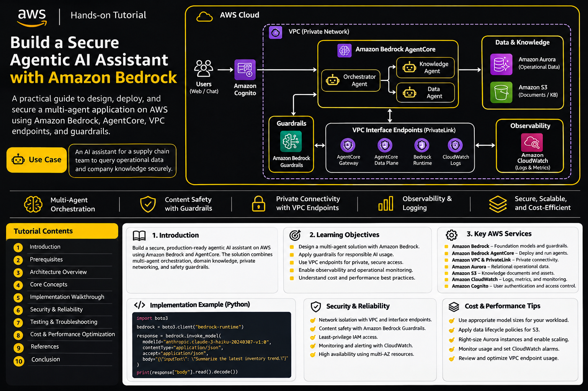

# Building a Secure AI Energy Operations Assistant on AWS

> An independently designed reference architecture for conversational energy analytics, grounded AI responses, and controlled operational actions.


## 1. Introduction

Commercial buildings generate large volumes of operational data through meters, sensors, building management systems, and maintenance records. Operations teams often need to combine these sources to understand energy consumption, investigate anomalies, and identify efficiency improvements.

This tutorial describes an AI-powered energy operations assistant that allows authorized users to:

- Ask natural-language questions about building energy consumption.
- Retrieve relevant information from engineering documentation.
- Analyze synthetic energy readings and historical trends.
- Request controlled operational reports.
- Receive responses grounded in retrieved information.
- Maintain secure access and observable application workflows.

The implementation is designed as an educational reference architecture, not a production-ready deployment.

### Learning objectives

By completing this tutorial, you should understand:

1. How to integrate foundation models into an AWS application.
2. How retrieval-augmented generation (RAG) improves factual grounding.
3. How to orchestrate multi-step AI workflows.
4. How to expose controlled business operations as tools.
5. How to secure APIs, data, and model interactions.
6. How to monitor, test, and optimize an AI application.

## 2. Prerequisites

- An AWS account with access to the required services.
- Familiarity with Python and REST APIs.
- Basic understanding of IAM, VPCs, and security groups.
- Python 3.11 or later.
- AWS CLI and Boto3.
- Familiarity with JSON, environment variables, and serverless applications.

Use a dedicated development account or sandbox. Apply budget alerts before deploying resources.

## 3. Independent reference architecture

### Use case

A facilities management company operates multiple commercial buildings. Its operations team needs a conversational interface to query energy readings, retrieve maintenance procedures, and generate energy performance summaries.

### Architecture components

| Component | Responsibility |
|---|---|
| Amazon Cognito | User authentication |
| Amazon API Gateway | Secure application API |
| AWS Lambda | Request handling and business logic |
| AWS Step Functions | Multi-step workflow orchestration |
| Amazon Bedrock | Foundation model inference |
| Amazon Bedrock Guardrails | Input and output safety controls |
| Amazon Bedrock Knowledge Bases | Retrieval from engineering documents |
| AWS IoT SiteWise | Building and equipment telemetry |
| Amazon S3 | Document and report storage |
| Amazon DynamoDB | Conversation and workflow metadata |
| Amazon CloudWatch | Logs, metrics, and alarms |
| AWS CloudTrail | API activity auditing |

### Architecture Diagram




### Request lifecycle

1. The user authenticates through Cognito.
2. API Gateway validates the request and forwards it to Lambda.
3. Lambda initiates a workflow using Step Functions.
4. The workflow determines which information sources are required.
5. Knowledge Bases retrieve relevant engineering documentation.
6. IoT SiteWise supplies operational telemetry.
7. Bedrock generates a response using the retrieved context and structured data.
8. Guardrails apply configured safety controls.
9. The workflow stores relevant metadata and returns the response.
10. CloudWatch and CloudTrail provide operational visibility and auditing.

The workflow is intentionally deterministic at the application level: the model may help interpret a request, but sensitive operational actions are handled by explicitly authorized application functions.

## 4. Core technical concepts

### 4.1 Foundation models

Foundation models generate and interpret natural language, summarize information, and reason over supplied context.

Amazon Bedrock provides managed access to foundation models through APIs.

Important considerations:

- Select models based on task complexity and latency requirements.
- Use structured prompts and explicit output expectations.
- Avoid providing unnecessary sensitive information.
- Validate model output before using it in downstream systems.
- Apply request limits and timeouts.

### 4.2 Retrieval-augmented generation

RAG combines information retrieval with model generation.

Instead of relying exclusively on model parameters, the application retrieves relevant source material and supplies it as context.

A typical RAG pipeline:

1. Collect engineering documents.
2. Extract and normalize document text.
3. Split documents into suitable chunks.
4. Generate embeddings.
5. Store embeddings in a vector index.
6. Retrieve relevant chunks for a user query.
7. Supply retrieved content to the model.
8. Return an answer with source references where available.

Example documents:

- Equipment maintenance procedures.
- Energy efficiency guidelines.
- Building operating manuals.
- Synthetic equipment specifications.

RAG improves access to domain-specific information but does not guarantee correctness. Retrieval quality, document freshness, and source validation remain important.

### 4.3 Workflow orchestration

Step Functions coordinates application tasks through explicit workflow states.

For example:

- Validate the request.
- Retrieve building telemetry.
- Retrieve supporting documents.
- Invoke the model.
- Validate the response.
- Store the report.
- Return the result.

This separates application control flow from model-generated reasoning and makes failures easier to isolate.

### 4.4 Controlled tool execution

A tool is an application function that performs a defined operation.

Example tools:

- `get_building_energy_summary`
- `get_equipment_status`
- `retrieve_maintenance_guidance`
- `generate_efficiency_report`

Each tool should have:

- A narrow responsibility.
- Explicit input validation.
- Authorization checks.
- Defined output schemas.
- Timeouts and error handling.
- Audit logging.

Never allow a language model to execute arbitrary SQL, shell commands, or unrestricted infrastructure operations.

### 4.5 Conversation state

DynamoDB can store application-level conversation metadata, such as:

- Conversation identifier.
- Authenticated user identifier.
- Request timestamp.
- Selected building.
- Workflow status.
- Report references.

Avoid storing complete sensitive conversations unless required by a documented retention policy.

## 5. Original implementation examples

The examples below illustrate application patterns using synthetic energy data. They are not tied to any certification challenge configuration.

### 5.1 Suggested project structure

```text
energy-operations-assistant/
├── src/
│   ├── api/
│   │   └── handler.py
│   ├── services/
│   │   ├── energy_service.py
│   │   ├── knowledge_service.py
│   │   └── model_service.py
│   ├── workflows/
│   │   └── workflow_definition.asl.json
│   └── common/
│       └── validation.py
├── tests/
│   ├── test_energy_service.py
│   └── test_validation.py
├── infrastructure/
│   └── template.yaml
├── sample_data/
│   └── building_energy_readings.json
├── requirements.txt
└── README.md
```

### 5.2 Synthetic energy data

```json
{
  "building_id": "BLDG-204",
  "reading_date": "2026-10-15",
  "energy_consumption_kwh": 1284.6,
  "peak_demand_kw": 96.2,
  "average_temperature_c": 23.8,
  "equipment_status": "operational"
}
```

This sample is illustrative and contains no real customer or building information.

### 5.3 Validate an energy query

```python
from dataclasses import dataclass
from datetime import date


@dataclass
class EnergyQuery:
    building_id: str
    start_date: date
    end_date: date


def validate_energy_query(query: EnergyQuery) -> None:
    if not query.building_id:
        raise ValueError("Building identifier is required")

    if query.start_date > query.end_date:
        raise ValueError("Start date must not exceed end date")

    if (query.end_date - query.start_date).days > 90:
        raise ValueError("Query range exceeds the allowed limit")
```

Validation should occur before any database or model invocation.

### 5.4 Invoke a foundation model

The following example uses the Bedrock Converse API. The model identifier should be selected from the models available in the deployment's AWS Region.

```python
import boto3

client = boto3.client(
    "bedrock-runtime",
    region_name="us-east-1"
)

def generate_energy_summary(context: str, question: str) -> str:
    response = client.converse(
        modelId="YOUR_SUPPORTED_MODEL_ID",
        system=[
            {
                "text": (
                    "You are an energy operations assistant. "
                    "Use only the supplied context. "
                    "If the evidence is insufficient, say so."
                )
            }
        ],
        messages=[
            {
                "role": "user",
                "content": [
                    {
                        "text": (
                            f"Reference information:\n{context}\n\n"
                            f"Question:\n{question}"
                        )
                    }
                ]
            }
        ],
        inferenceConfig={
            "maxTokens": 500,
            "temperature": 0.2
        }
    )

    return response["output"]["message"]["content"][0]["text"]
```

Production implementations should additionally configure appropriate guardrails, retries, timeouts, request tracing, and output validation.

### 5.5 Controlled energy retrieval tool

```python
def get_building_energy_summary(
    building_id: str,
    readings: list[dict]
) -> dict:
    if not building_id:
        raise ValueError("Building ID is required")

    selected = [
        item for item in readings
        if item["building_id"] == building_id
    ]

    if not selected:
        return {
            "building_id": building_id,
            "record_count": 0,
            "average_consumption_kwh": None
        }

    average = sum(
        item["energy_consumption_kwh"]
        for item in selected
    ) / len(selected)

    return {
        "building_id": building_id,
        "record_count": len(selected),
        "average_consumption_kwh": round(average, 2)
    }
```

In a deployed system, replace the in-memory list with an authorized IoT SiteWise or application data query.

## 6. Security and reliability

### Identity and access management

- Authenticate users before accepting application requests.
- Apply least-privilege IAM roles to each execution component.
- Separate development and production environments.
- Restrict access to data by building and user authorization.
- Avoid long-lived credentials in source code.

### Network security

For workloads that require private connectivity:

- Place supported compute resources in private subnets.
- Use interface or gateway endpoints where appropriate.
- Enable private DNS where supported and required.
- Restrict endpoint security groups to necessary traffic.
- Use NAT only for required destinations that do not have suitable private connectivity.
- Validate DNS resolution and routing from the actual workload environment.

Private networking reduces exposure but does not replace IAM authorization or application-level access controls.

### Model safety

- Apply guardrails to relevant user inputs and model outputs.
- Treat retrieved documents as untrusted input.
- Protect against prompt injection in external content.
- Validate tool arguments independently of model output.
- Require human approval for high-impact operational changes.

### Reliability

- Use bounded retries with exponential backoff.
- Configure Lambda timeouts and concurrency limits.
- Add workflow failure and timeout states.
- Make report generation idempotent.
- Use dead-letter or failure-handling patterns where appropriate.
- Test behavior when model and retrieval services are unavailable.

## 7. Testing and troubleshooting

### Test strategy

| Test area | Example validation |
|---|---|
| Input validation | Reject invalid building IDs and date ranges |
| Authentication | Reject unauthenticated API requests |
| Authorization | Prevent access to another building's data |
| Retrieval | Confirm relevant documents are returned |
| Model output | Verify unsupported claims are not presented as facts |
| Tool execution | Reject invalid tool parameters |
| Workflow | Test retries and failure transitions |
| Networking | Verify private service connectivity |
| Observability | Confirm errors and latency are recorded |

### Common issues

**Model invocation fails**

- Verify model access and regional availability.
- Check the execution role's permissions.
- Inspect the service response and CloudWatch logs.
- Confirm request format and model-specific constraints.

**Knowledge retrieval returns irrelevant content**

- Review document extraction quality.
- Revisit chunking and metadata.
- Check embedding model compatibility.
- Evaluate retrieval quality with a representative test set.

**Private endpoint connectivity fails**

- Confirm endpoint status.
- Verify subnet and security-group configuration.
- Check VPC DNS attributes and private DNS.
- Review route tables and network ACLs.
- Validate the endpoint's supported service name and Region.

**Workflow execution times out**

- Identify the slowest state.
- Check downstream service latency.
- Review retry and timeout settings.
- Avoid unbounded synchronous operations.

## 8. Cost and performance optimization

### Cost management

- Select a model appropriate to the task rather than defaulting to the largest model.
- Limit input context and output token counts.
- Cache suitable retrieval results.
- Apply S3 lifecycle policies to old reports.
- Set log retention periods.
- Monitor endpoint and compute costs.
- Use budgets and alerts to detect unexpected spending.

### Performance management

- Use asynchronous workflows for long-running tasks.
- Avoid repeated retrieval of identical documents.
- Apply pagination to large data queries.
- Use appropriate DynamoDB access patterns.
- Monitor model latency and token consumption.
- Measure end-to-end workflow latency, not just model response time.

## 9. Official documentation

- [Amazon Bedrock](https://docs.aws.amazon.com/bedrock/)
- [Amazon Bedrock Converse API](https://docs.aws.amazon.com/bedrock/latest/userguide/conversation-inference.html)
- [Amazon Bedrock Guardrails](https://docs.aws.amazon.com/bedrock/latest/userguide/guardrails.html)
- [Amazon Bedrock Knowledge Bases](https://docs.aws.amazon.com/bedrock/latest/userguide/knowledge-base.html)
- [AWS Step Functions](https://docs.aws.amazon.com/step-functions/)
- [AWS Lambda](https://docs.aws.amazon.com/lambda/)
- [Amazon API Gateway](https://docs.aws.amazon.com/apigateway/)
- [Amazon Cognito](https://docs.aws.amazon.com/cognito/)
- [Amazon VPC endpoints](https://docs.aws.amazon.com/vpc/latest/privatelink/vpc-endpoints.html)
- [AWS IoT SiteWise](https://docs.aws.amazon.com/iot-sitewise/)
- [Amazon DynamoDB](https://docs.aws.amazon.com/dynamodb/)
- [Amazon CloudWatch](https://docs.aws.amazon.com/cloudwatch/)
- [AWS Well-Architected Framework](https://docs.aws.amazon.com/wellarchitected/latest/framework/welcome.html)

## 10. Conclusion

A reliable AI operations assistant requires more than a foundation model. It combines secure identity, controlled business tools, retrieval, workflow orchestration, data governance, network isolation, and operational monitoring.

The architecture in this tutorial demonstrates how these capabilities can be assembled into an independently designed AWS application. The same engineering principles can be applied to facilities management, industrial monitoring, logistics, retail operations, and other enterprise AI use cases.

**Key takeaway:** Build AI systems with explicit control boundaries. Let models interpret and generate; let validated application services authorize, execute, and audit operational actions.

**Disclaimer:** This is an independently designed educational reference architecture, not a production deployment blueprint or a guarantee of copyright or licensing compliance.
