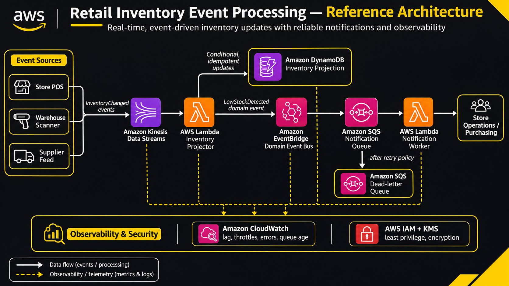

# Real-Time Retail Inventory Event Processing on AWS

> An independently designed event-driven architecture for processing inventory changes, maintaining consistent stock projections, and delivering reliable operational notifications.

## 1. Introduction

Modern retail platforms receive inventory changes from multiple sources, including point-of-sale systems, warehouse scanners, supplier integrations, and inventory management applications.

Processing these events synchronously can introduce latency, tightly coupled services, and inconsistent inventory records during periods of high demand.

This project demonstrates an event-driven architecture using AWS services to ingest inventory events, process them asynchronously, maintain a materialized inventory view, and route important business notifications.

### Project objectives

- Build a scalable event ingestion pipeline.
- Understand partition keys and stream distribution.
- Process events asynchronously using AWS Lambda.
- Maintain an idempotent inventory projection.
- Implement reliable notification delivery.
- Handle failed events using retry mechanisms and dead-letter queues.
- Monitor throughput, processing latency, and failures.
- Apply security and cost optimization practices.

### Independent use case

A retail organization operates multiple stores and distribution centers. Each location generates inventory events whenever stock is received, sold, transferred, or adjusted.

The platform must:

1. Accept high-volume inventory events.
2. Process updates without blocking producers.
3. Maintain the latest inventory state for each product and location.
4. Detect low-stock conditions.
5. Notify purchasing and store operations teams.
6. Preserve failed messages for investigation.

---

## 2. Prerequisites

### AWS services

| Service | Purpose |
|---|---|
| Amazon Kinesis Data Streams | Real-time event ingestion |
| AWS Lambda | Event processing |
| Amazon DynamoDB | Inventory state storage |
| Amazon EventBridge | Domain event routing |
| Amazon SQS | Asynchronous notification buffering |
| Amazon CloudWatch | Monitoring and alerting |
| AWS IAM | Identity and access management |
| AWS KMS | Encryption key management |

### Development environment

- Python 3.11 or later
- AWS CLI
- Boto3
- An AWS account
- Appropriate IAM permissions
- Git and GitHub

Install the Python dependency:

```bash
pip install boto3 pytest
```

Configure AWS credentials using an approved authentication mechanism, preferably IAM Identity Center or temporary role credentials.

Never commit credentials, access keys, or environment-specific secrets.

---

## 3. Reference Architecture

### Architecture overview



The solution separates ingestion, processing, state management, and notification delivery.

**Layer 1 — Event producers**

Inventory events originate from:
- Store point-of-sale systems.
- Warehouse scanning applications.
- Supplier integration services.

Producers publish inventory changes to Amazon Kinesis Data Streams.

**Layer 2 — Streaming ingestion**

Kinesis provides a durable, ordered stream of records within each shard.

Partition keys determine how records are distributed across shards.

A composite product-location key helps distribute traffic while maintaining consistent ordering for events belonging to the same inventory entity.

**Layer 3 — Event processing**

AWS Lambda consumes records from Kinesis through an event source mapping.

The processing function:
- Decodes incoming events.
- Validates their structure.
- Checks event versions.
- Rejects duplicate or stale updates.
- Updates the inventory projection.

**Layer 4 — Domain event routing**

When inventory reaches a business-defined threshold, a low-stock domain event can be routed through Amazon EventBridge.

EventBridge routes matching events to an SQS notification queue.

**Layer 5 — Notification processing**

A separate Lambda worker consumes notification messages from SQS.

Failed messages are retried and eventually moved to a dead-letter queue according to the configured redrive policy.

**Layer 6 — Observability and security**

CloudWatch monitors stream throughput, consumer lag, processing errors, and queue age.

IAM controls access between services, while KMS supports encryption at rest.

### Data flow

```text
Inventory Producers
        |
        v
Amazon Kinesis Data Streams
        |
        v
AWS Lambda Processor
        |
        +-----------> DynamoDB Inventory Projection
        |
        +-----------> EventBridge
                            |
                            v
                       Amazon SQS
                            |
                            v
                     Notification Lambda
                            |
                            v
                   Operations / Purchasing

Failed Notifications
        |
        v
Amazon SQS Dead-Letter Queue

CloudWatch monitors the processing pipeline.
IAM and KMS provide security controls.
```

### Architecture design decisions

| Design decision | Reason |
|---|---|
| Asynchronous ingestion | Decouples producers from consumers |
| Partition-key distribution | Reduces shard hotspots |
| Lambda event source mapping | Simplifies stream consumption |
| DynamoDB projection | Supports low-latency inventory lookups |
| EventBridge routing | Separates business events from consumers |
| SQS buffering | Absorbs temporary notification spikes |
| Dead-letter queue | Preserves messages that repeatedly fail |

---

## 4. Core Technical Concepts

### 4.1 Stream partitioning

Amazon Kinesis Data Streams distributes records across shards using partition keys.

A partition key is hashed to determine the destination shard.

Using a low-cardinality key can concentrate traffic on a small number of shards.

For example, using only a store identifier might create uneven distribution if a few stores generate substantially more events than others.

A composite key provides more distribution opportunities:

```python
partition_key = f"{sku_id}#{location_id}"
```

This maintains a stable partition assignment for a product at a particular location.

The key should be selected based on both traffic distribution and ordering requirements.

Increasing the number of shards alone does not necessarily solve a hot-key problem.

### 4.2 Capacity management

Kinesis offers different capacity modes.

**Provisioned mode**

- Capacity is managed through shard allocation.
- Provides explicit throughput planning.
- Requires monitoring and capacity adjustments.

**On-Demand mode**

- AWS manages stream capacity automatically within the service's scaling characteristics.
- Reduces manual capacity planning.
- Is useful for workloads with variable traffic.

Capacity selection should consider throughput predictability, traffic patterns, cost, and scaling requirements.

### 4.3 Asynchronous event processing

Lambda event source mappings poll Kinesis and invoke functions with batches of records.

This architecture allows producers to continue publishing events independently of consumer execution.

However, stream processing is at-least-once. Duplicate processing can occur.

Consequently, consumer functions must be designed to handle repeated events safely.

### 4.4 Idempotency

An operation is idempotent when processing the same event repeatedly does not produce unintended additional changes.

For inventory processing, use a monotonically increasing version number for each product-location combination.

A conditional DynamoDB write can prevent stale updates from replacing newer inventory states.

### 4.5 Event time and processing time

- Event time: when the inventory change actually occurred.
- Processing time: when the AWS processing function handles it.

These timestamps can differ because of network delays, retries, and temporary service interruptions.

Business logic should use event timestamps when the actual occurrence time matters.

---

## 5. Implementation Examples

The following examples use an independent event schema and generic resource references.

### 5.1 Inventory event schema

An inventory change can be represented as:

```json
{
  "event_id": "evt-7f29a1",
  "event_type": "InventoryChanged",
  "sku_id": "SKU-4821",
  "location_id": "WH-018",
  "available_units": 42,
  "version": 108,
  "event_time": "2026-11-10T08:30:00Z"
}
```

Field descriptions:

| Field | Description |
|---|---|
| event_id | Unique event identifier |
| event_type | Business event classification |
| sku_id | Product identifier |
| location_id | Store or warehouse identifier |
| available_units | Latest available stock quantity |
| version | Monotonically increasing entity version |
| event_time | Event occurrence timestamp |

### 5.2 Publishing events to Kinesis

The producer serializes inventory events and publishes them in batches.

```python
import json
import time
import random
import boto3

kinesis = boto3.client("kinesis")


def publish_inventory_events(stream_name, events):

    pending = [
        {
            "Data": json.dumps(event).encode("utf-8"),
            "PartitionKey": (
                f"{event['sku_id']}#{event['location_id']}"
            )
        }
        for event in events
    ]

    for attempt in range(5):

        if not pending:
            break

        response = kinesis.put_records(
            StreamName=stream_name,
            Records=pending
        )

        pending = [
            record
            for record, result in zip(
                pending,
                response["Records"]
            )
            if "ErrorCode" in result
        ]

        if pending:
            delay = min(2 ** attempt, 8)
            time.sleep(delay + random.random())

    if pending:
        raise RuntimeError(
            f"{len(pending)} inventory events remain unpublished"
        )
```

Important considerations:

- `PutRecords` can partially succeed.
- Failed records should be retried individually.
- Exponential backoff reduces pressure during throttling.
- Retries must be bounded.
- Event identifiers should remain stable across retries.

For production systems, also implement request timeouts, structured logging, retry metrics, and a durable mechanism for retaining unpublished events.

### 5.3 Processing Kinesis records with Lambda

The consumer validates events and updates the inventory projection.

The example uses conditional writes to reject stale or duplicate versions.

```python
import os
import json
import base64
import boto3

from botocore.exceptions import ClientError

dynamodb = boto3.resource("dynamodb")

table = dynamodb.Table(
    os.environ["INVENTORY_TABLE"]
)


def handler(event, context):

    failures = []

    for record in event["Records"]:

        sequence_number = (
            record["kinesis"]["sequenceNumber"]
        )

        try:

            payload = json.loads(
                base64.b64decode(
                    record["kinesis"]["data"]
                ).decode("utf-8")
            )

            required = [
                "event_id",
                "sku_id",
                "location_id",
                "available_units",
                "version",
                "event_time"
            ]

            if any(key not in payload for key in required):
                raise ValueError("Required event field missing")

            if (
                not isinstance(payload["available_units"], int)
                or payload["available_units"] < 0
            ):
                raise ValueError("Invalid inventory quantity")

            if (
                not isinstance(payload["version"], int)
                or payload["version"] < 0
            ):
                raise ValueError("Invalid event version")

            table.put_item(
                Item={
                    "sku_id": payload["sku_id"],
                    "location_id": payload["location_id"],
                    "available_units": payload["available_units"],
                    "source_version": payload["version"],
                    "last_event_id": payload["event_id"],
                    "updated_at": payload["event_time"]
                },
                ConditionExpression=(
                    "attribute_not_exists(source_version) "
                    "OR source_version < :version"
                ),
                ExpressionAttributeValues={
                    ":version": payload["version"]
                }
            )

        except ClientError as exc:

            error_code = exc.response["Error"]["Code"]

            if error_code == "ConditionalCheckFailedException":
                # Duplicate or stale event: acknowledge safely.
                continue

            failures.append({
                "itemIdentifier": sequence_number
            })

            # Stop at the first unexpected failure to preserve
            # the stream checkpoint ordering.
            break

        except Exception:

            failures.append({
                "itemIdentifier": sequence_number
            })

            break

    return {
        "batchItemFailures": failures
    }
```

**Important deployment configuration**

Enable `ReportBatchItemFailures` on the Lambda Kinesis event source mapping.

Without that configuration, Lambda will not interpret the partial batch failure response as intended.

The example assumes a single ordered version sequence for each product-location pair. A production implementation should also enforce the event schema, version contract, and producer-side uniqueness requirements.

### 5.4 Inventory table design

Use a DynamoDB table with:

| Attribute | Role |
|---|---|
| `sku_id` | Partition key |
| `location_id` | Sort key |
| `available_units` | Current inventory |
| `source_version` | Latest accepted version |
| `last_event_id` | Most recently accepted event |
| `updated_at` | Last update timestamp |

This design supports efficient lookups by product and location.

Conditional writes prevent stale versions from overwriting newer state.

### 5.5 Notification workflow

When the inventory projection indicates that available stock has crossed a business threshold, publish a domain event.

Example:

```json
{
  "source": "retail.inventory",
  "detail-type": "LowStockDetected",
  "detail": {
    "sku_id": "SKU-4821",
    "location_id": "WH-018",
    "available_units": 4,
    "threshold": 10
  }
}
```

EventBridge can route this event to a notification queue.

A separate Lambda worker processes the message and delivers the notification.

For stronger delivery guarantees, implement a transactional outbox pattern. A database update and an EventBridge publication are not automatically one atomic transaction. The outbox pattern provides a durable way to relay committed business events.

---

## 6. Security and Reliability

### Security controls

**IAM**

- Use separate execution roles for producers and consumers.
- Restrict Kinesis write permissions to the required stream.
- Restrict DynamoDB access to the inventory table.
- Restrict notification workers to their required queue.
- Avoid wildcard permissions wherever practical.

**Encryption**

- Enable encryption at rest using AWS KMS where appropriate.
- Use TLS for service communication.
- Protect application secrets using AWS Secrets Manager when needed.

**Network security**

- Use VPC endpoints where private connectivity is required.
- Restrict network access to trusted application components.
- Avoid exposing internal processing services unnecessarily.

**Data protection**

- Validate incoming event payloads.
- Avoid logging sensitive customer information.
- Apply retention policies based on business and regulatory requirements.

### Reliability controls

| Failure scenario | Recommended control |
|---|---|
| Producer throttling | Bounded retries and backoff |
| Uneven stream distribution | Appropriate partition-key design |
| Lambda processing failure | Partial batch responses |
| Duplicate events | Idempotent consumers |
| Stale inventory updates | Conditional writes |
| Notification worker failure | SQS retries and DLQ |
| Temporary downstream outage | Queue-based buffering |
| Missed operational alerts | CloudWatch alarms |

A DLQ should have a documented replay and investigation procedure. Moving failed records into a queue does not automatically resolve the underlying processing problem.

---

## 7. Testing and Troubleshooting

### Testing strategy

Test the system at multiple levels.

**Unit testing**

- Validate inventory event schemas.
- Test Base64 decoding.
- Test invalid quantities.
- Test duplicate event handling.
- Test stale version rejection.

**Integration testing**

- Publish test events to Kinesis.
- Verify Lambda invocation.
- Inspect DynamoDB projection updates.
- Verify EventBridge routing.
- Verify SQS delivery.

**Load testing**

- Generate realistic inventory event volumes.
- Test burst traffic.
- Observe partition distribution.
- Monitor producer retry rates.
- Measure end-to-end processing latency.

**Failure testing**

- Introduce malformed messages.
- Simulate DynamoDB throttling.
- Temporarily disable notification processing.
- Verify retry behavior.
- Verify DLQ routing and replay procedures.

### Troubleshooting matrix

| Symptom | Possible cause | Investigation |
|---|---|---|
| Records not appearing | Incorrect producer configuration | Inspect producer logs and Kinesis metrics |
| Write throttling | Hot partition key or insufficient capacity | Examine throttled records and key distribution |
| Consumer lag increasing | Slow processing | Inspect iterator age and Lambda duration |
| Duplicate updates | At-least-once delivery | Verify idempotency logic |
| Inventory overwritten by old data | Missing version checks | Inspect conditional writes |
| Notifications delayed | Queue backlog | Monitor SQS message age |
| Messages in DLQ | Repeated worker failures | Inspect message payloads and worker logs |

### Operational metrics

Monitor the following:

| Component | Metrics |
|---|---|
| Kinesis | IncomingRecords, IncomingBytes, throttled records |
| Lambda | Errors, Duration, ConcurrentExecutions |
| DynamoDB | ConsumedWriteCapacityUnits, ThrottledRequests |
| SQS | ApproximateAgeOfOldestMessage, ApproximateNumberOfMessagesVisible |
| CloudWatch | Alarm state and processing trends |

Useful Kinesis metrics include `GetRecords.IteratorAgeMilliseconds` and `WriteProvisionedThroughputExceeded`.

A rising iterator age indicates that consumers are falling behind the stream.

---

## 8. Cost and Performance Optimization

### Capacity optimization

Select the Kinesis capacity mode according to workload characteristics.

For predictable traffic, provisioned capacity may offer more direct capacity planning.

For variable workloads, on-demand capacity can reduce operational overhead.

### Lambda optimization

- Use appropriate batch sizes.
- Tune memory and timeout settings.
- Avoid unnecessary network calls.
- Reuse SDK clients outside the handler.
- Use partial batch failure reporting.
- Tune concurrency based on downstream capacity.

### DynamoDB optimization

- Choose partition keys that distribute workload.
- Avoid unnecessary secondary indexes.
- Use conditional writes for state consistency.
- Evaluate on-demand versus provisioned billing.
- Monitor hot-key behavior.

### Observability optimization

Enhanced Kinesis shard-level monitoring provides additional visibility but incurs additional costs.

Enable it when detailed shard diagnostics justify the expense.

Use dashboards and alarms for the operational signals that matter rather than collecting every possible metric without a clear purpose.

### Cost review checklist

- Kinesis capacity and data ingestion volume.
- Lambda invocations, duration, and concurrency.
- DynamoDB read and write consumption.
- SQS requests and message retention.
- EventBridge events.
- CloudWatch metrics, logs, and alarms.
- KMS requests and key usage.

Use AWS Cost Explorer and service-specific pricing calculators to estimate the expected monthly expenditure.

---

## 9. Official Documentation

The following AWS documentation provides the technical foundation for the implementation.

| Topic | Official documentation |
|---|---|
| Kinesis concepts | https://docs.aws.amazon.com/streams/latest/dev/key-concepts.html |
| Kinesis capacity modes | https://docs.aws.amazon.com/streams/latest/dev/how-do-i-size-a-stream.html |
| Kinesis monitoring | https://docs.aws.amazon.com/streams/latest/dev/monitoring-with-cloudwatch.html |
| Lambda with Kinesis | https://docs.aws.amazon.com/lambda/latest/dg/with-kinesis.html |
| Lambda event source configuration | https://docs.aws.amazon.com/lambda/latest/dg/services-kinesis-parameters.html |
| Partial batch failures | https://docs.aws.amazon.com/lambda/latest/dg/services-kinesis-batchfailurereporting.html |
| Lambda failure destinations | https://docs.aws.amazon.com/lambda/latest/dg/kinesis-on-failure-destination.html |
| DynamoDB conditional expressions | https://docs.aws.amazon.com/amazondynamodb/latest/developerguide/Expressions.ConditionExpressions.html |
| DynamoDB concurrency control | https://docs.aws.amazon.com/amazondynamodb/latest/developerguide/BestPractices_ImplementingVersionControl.html |
| SQS dead-letter queues | https://docs.aws.amazon.com/AWSSimpleQueueService/latest/SQSDeveloperGuide/sqs-dead-letter-queues.html |
| IAM best practices | https://docs.aws.amazon.com/IAM/latest/UserGuide/best-practices.html |

---

## 10. Conclusion

This project demonstrates how to build an event-driven inventory processing system using managed AWS services.

The architecture separates event ingestion from downstream processing, uses partition keys to distribute workload, and maintains inventory projections using conditional writes.

Asynchronous notification processing provides additional decoupling, while retry mechanisms, dead-letter queues, and CloudWatch monitoring improve operational resilience.

The most important engineering principles demonstrated are:

1. Design partition keys around both distribution and ordering requirements.
2. Treat stream processing as at-least-once delivery.
3. Make consumers idempotent.
4. Separate ingestion from business processing.
5. Design explicit failure and recovery mechanisms.
6. Monitor consumer lag and downstream bottlenecks.
7. Apply least-privilege security and cost-aware capacity planning.

The same principles can be adapted to order processing, logistics, financial transaction events, IoT telemetry, and other high-throughput event-driven systems.

---

## Repository Structure

A suggested GitHub repository layout:

```text
retail-inventory-streaming/
│
├── README.md
│
├── docs/
│   └── AWS-Datastreaming-arch.png
│
├── producer/
│   ├── publisher.py
│   └── requirements.txt
│
├── consumer/
│   ├── inventory_processor.py
│   └── requirements.txt
│
├── tests/
│   ├── test_publisher.py
│   ├── test_processor.py
│   └── test_idempotency.py
│
├── infrastructure/
│   └── README.md
│
└── .gitignore
```

### Suggested `.gitignore`

```gitignore
.env
.env.*
!.env.example
__pycache__/
*.py[cod]
.pytest_cache/
.venv/
.aws/
*.log
```

**Disclaimer:** This is an independently designed educational reference architecture, not a production deployment blueprint or a guarantee of copyright or licensing compliance.
