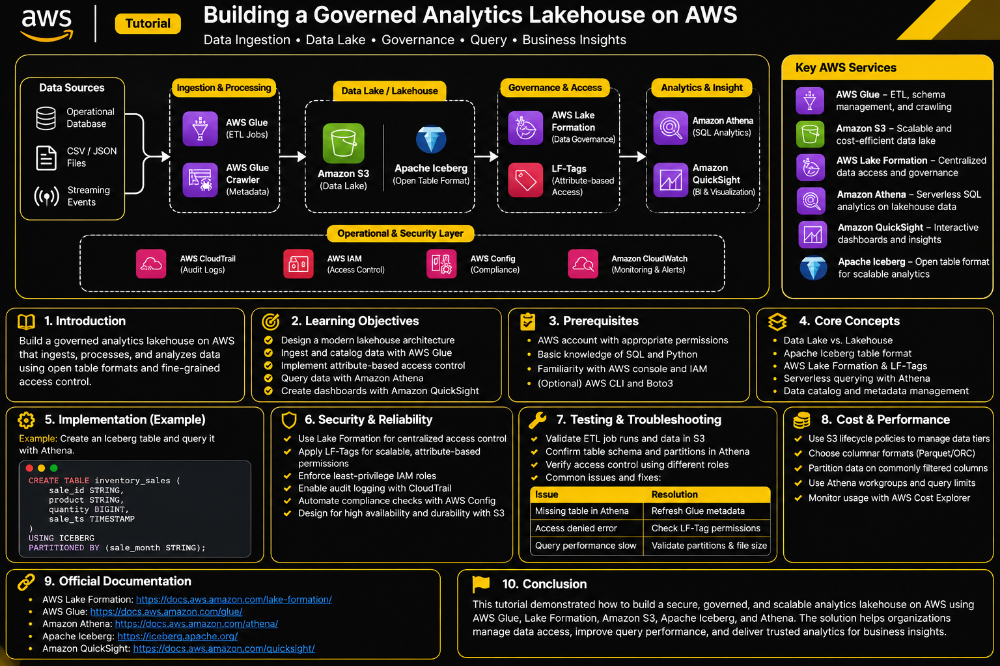

# Building a Governed Smart-Building Analytics Lakehouse on AWS

A practical engineering reference for ingesting telemetry, managing analytical data with Apache Iceberg, implementing fine-grained governance, and delivering scalable analytics.

> **Project scope:** This is an independently designed reference architecture for smart-building analytics. It is an educational implementation, not a reproduction of a certification assessment.

---

## 1. Introduction

Commercial buildings generate data from electricity meters, HVAC systems, occupancy sensors, and maintenance platforms. Analyzing these sources independently makes it difficult to identify energy inefficiencies, detect abnormal consumption, and understand operational trends.

This project introduces a cloud-native data lakehouse that consolidates these data sources into a governed analytical platform.

The architecture uses Amazon S3 for durable storage, AWS Glue for data integration, Apache Iceberg for table management, AWS Lake Formation for access governance, and Amazon Athena for SQL analytics.

### Learning objectives

- Design a multi-source data ingestion architecture.
- Understand the difference between a data lake and a lakehouse.
- Implement incremental data processing and deduplication.
- Understand Apache Iceberg schema and partition evolution.
- Implement attribute-based data governance.
- Apply row-level and column-level access controls.
- Improve query performance and manage storage costs.

## 2. Prerequisites

- An AWS account with permissions to create the required resources.
- Familiarity with Python, SQL, and basic cloud architecture.
- Basic understanding of Amazon S3 and IAM.
- Familiarity with Apache Spark is beneficial.
- AWS CLI and an AWS SDK for Python (Boto3) for optional automation.

Use a non-production AWS account and establish budget alerts before deploying resources.

## 3. Reference architecture

### Business scenario

A property management organization operates several commercial buildings. Each building generates:

| Data source | Example data |
|---|---|
| Electricity meters | Energy consumption, voltage, readings |
| HVAC controllers | Temperature, equipment state |
| Occupancy sensors | Occupancy counts, timestamps |
| Maintenance platform | Work orders, equipment inspections |

### Logical data flow

**Streaming ingestion**

1. Building sensors publish telemetry.
2. Amazon Kinesis Data Streams receives the events.
3. AWS Glue Streaming processes and transforms the records.
4. Validated records are written into the analytical storage layer.

**Batch ingestion**

1. Maintenance systems export periodic files.
2. Files arrive in an Amazon S3 landing location.
3. Amazon EventBridge detects relevant object events.
4. AWS Step Functions coordinates validation and processing.
5. AWS Lambda performs lightweight validation.
6. AWS Glue processes the validated records.

**Storage and analytics**

1. Amazon S3 stores raw, refined, and analytical data.
2. Apache Iceberg manages analytical tables and their metadata.
3. AWS Glue Data Catalog maintains table metadata.
4. AWS Lake Formation enforces data access policies.
5. Amazon Athena provides SQL-based analytics.
6. Amazon QuickSight can visualize analytical results.

### Suggested storage organization

```text
s3://<analytics-bucket>/
    landing/
        telemetry/
        maintenance/
    refined/
        energy/
        equipment/
    warehouse/
        energy_readings/
        maintenance_events/
    quarantine/
        invalid_records/
```

The storage layers have distinct responsibilities:

- **Landing:** Preserves incoming source records.
- **Refined:** Contains validated and standardized records.
- **Warehouse:** Contains managed analytical tables.
- **Quarantine:** Isolates records that fail validation.

### Architecture diagram



## 4. Core technical concepts

### 4.1 Data lake versus data lakehouse

A data lake stores large volumes of structured, semi-structured, and unstructured information in object storage.

A lakehouse adds table-management capabilities, including transactional writes, schema evolution, metadata management, and analytical query support.

Apache Iceberg provides an open table format that enables these capabilities on object storage.

### 4.2 Apache Iceberg

Important Iceberg capabilities include:

- ACID-style transactional table operations.
- Schema evolution.
- Hidden partitioning.
- Snapshot-based time travel.
- Record-level updates and deletes.
- Metadata-based table management.

Iceberg stores table metadata and data files separately. A table update creates a new metadata state rather than requiring an entire dataset to be rewritten.

### 4.3 Incremental ingestion and idempotency

Distributed data systems can deliver the same event more than once.

A reliable ingestion pipeline should not assume that every incoming record is unique.

For telemetry, a globally unique `reading_id` can act as the record identifier.

The ingestion process should:

1. Validate required fields.
2. Reject malformed records.
3. Deduplicate incoming records.
4. Compare incoming records with existing records.
5. Apply updates only when the incoming version is newer.

This makes processing more resilient to retries and repeated deliveries.

### 4.4 Schema evolution

Source systems change over time. For example, a meter vendor might increase the precision or range of a measurement field.

Iceberg supports certain compatible schema changes, including widening an integer column to a larger integer type.

Schema evolution should be intentional and tested before production deployment.

### 4.5 Partitioning

Partitioning reduces unnecessary data scans by organizing records around commonly filtered dimensions.

For energy analytics, useful partitioning dimensions include:

- Measurement month.
- Building identifier.

Partitioning should be based on actual query patterns and data volume. Excessively granular partitions can create many small files and increase metadata overhead.

### 4.6 Data governance

AWS Lake Formation provides centralized permissions for Data Catalog resources.

Its capabilities include:

- Table-level permissions.
- Column-level permissions.
- Row-level filtering.
- Cell-level filtering.
- Attribute-based access using LF-Tags.

IAM controls access to AWS resources, while Lake Formation provides fine-grained governance over governed analytical data. Both layers must be configured correctly.

## 5. Implementation examples

The following examples illustrate the core design using independent schemas and resource placeholders.

### 5.1 Create an Iceberg table

The following Athena SQL creates an analytical table for energy readings.

```sql
CREATE TABLE energy_readings (
    reading_id STRING,
    building_id STRING,
    meter_id STRING,
    measured_at TIMESTAMP,
    energy_kwh DOUBLE,
    ingestion_time TIMESTAMP
)
PARTITIONED BY (
    month(measured_at),
    building_id
)
LOCATION 's3://<analytics-bucket>/warehouse/energy_readings/'
TBLPROPERTIES (
    'table_type' = 'ICEBERG',
    'format' = 'parquet'
);
```

Replace the storage location with an appropriate bucket and prefix.

The month transform enables time-based pruning, while building-level partitioning supports common building-specific queries.

### 5.2 Validate incoming telemetry

Example Python validation logic:

```python
def validate_reading(record):
    required_fields = [
        "reading_id",
        "building_id",
        "meter_id",
        "measured_at",
        "energy_kwh"
    ]

    for field in required_fields:
        value = record.get(field)

        if value is None or str(value).strip() == "":
            return False

    try:
        energy = float(record["energy_kwh"])

        if energy < 0:
            return False

    except (ValueError, TypeError):
        return False

    return True
```

Invalid records should be isolated for investigation rather than silently discarded.

### 5.3 Deduplicate and merge records

A simplified Spark SQL approach:

```sql
CREATE OR REPLACE TEMP VIEW latest_readings AS
SELECT
    reading_id,
    building_id,
    meter_id,
    measured_at,
    energy_kwh,
    ingestion_time
FROM (
    SELECT
        *,
        ROW_NUMBER() OVER (
            PARTITION BY reading_id
            ORDER BY ingestion_time DESC
        ) AS row_num
    FROM staging_readings
)
WHERE row_num = 1;
```

Merge the latest records into the Iceberg table:

```sql
MERGE INTO glue_catalog.energy_lake.energy_readings AS target
USING latest_readings AS source
ON target.reading_id = source.reading_id

WHEN MATCHED
AND source.ingestion_time > target.ingestion_time
THEN UPDATE SET
    energy_kwh = source.energy_kwh,
    measured_at = source.measured_at,
    ingestion_time = source.ingestion_time

WHEN NOT MATCHED
THEN INSERT (
    reading_id,
    building_id,
    meter_id,
    measured_at,
    energy_kwh,
    ingestion_time
)
VALUES (
    source.reading_id,
    source.building_id,
    source.meter_id,
    source.measured_at,
    source.energy_kwh,
    source.ingestion_time
);
```

The source view is deduplicated before merging. The merge condition prevents older repeated records from overwriting newer readings.

For production, use stable event identifiers, explicit late-arrival policies, and an appropriate checkpoint strategy for streaming jobs.

### 5.4 Query analytical data

Example: Calculate monthly energy consumption by building.

```sql
SELECT
    building_id,
    date_trunc('month', measured_at) AS reporting_month,
    SUM(energy_kwh) AS total_energy_kwh
FROM energy_readings
WHERE measured_at >= TIMESTAMP '2026-01-01 00:00:00'
  AND measured_at < TIMESTAMP '2026-04-01 00:00:00'
GROUP BY
    building_id,
    date_trunc('month', measured_at)
ORDER BY
    reporting_month,
    total_energy_kwh DESC;
```

The time-range predicate helps Iceberg eliminate irrelevant partitions.

### 5.5 Design an access-control model

A possible governance model:

| Principal | Data classification | Access |
|---|---|---|
| Platform engineering | Internal | Operational datasets |
| Energy analysts | Internal | Building energy measurements |
| Regional operations | Restricted by region | Assigned building data |
| External reporting | Public or approved aggregate | Sanitized metrics |

Use LF-Tags to classify resources and grant permissions based on matching attributes.

Use data filters when access must be restricted to particular rows or columns.

An important distinction: LF-Tag assignment permissions and permissions to query the underlying tables are separate governance concerns.

## 6. Security and reliability

### Identity and access management

- Use dedicated IAM roles for individual workloads.
- Apply least-privilege permissions.
- Avoid long-lived credentials in application code.
- Separate deployment permissions from runtime permissions.

### Data protection

- Enable encryption at rest using appropriate AWS KMS keys.
- Use TLS for data transfers.
- Restrict S3 bucket access.
- Prevent unintended public access.
- Apply appropriate retention policies.

### Pipeline reliability

- Use bounded retries with exponential backoff.
- Implement dead-letter or quarantine handling where appropriate.
- Make processing idempotent.
- Monitor failed executions.
- Preserve source records for replay and recovery.

### Observability

Use Amazon CloudWatch for:

- Pipeline execution metrics.
- Processing failures.
- Streaming throughput.
- Data delivery latency.
- Resource utilization.

Use AWS CloudTrail for auditing API activity and AWS Config for configuration compliance.

## 7. Testing and troubleshooting

| Symptom | Investigation |
|---|---|
| Missing records | Check ingestion offsets, source delivery, and processing checkpoints |
| Duplicate readings | Verify event identifiers and merge conditions |
| Schema incompatibility | Compare source schema with the Iceberg table schema |
| Missing Athena table | Verify Glue Data Catalog metadata |
| Access denied | Inspect IAM and Lake Formation permissions |
| Excessive query scans | Review partition transforms and filter predicates |
| Slow ingestion | Inspect streaming throughput and processing capacity |
| Growing storage usage | Review small files, snapshots, and retention policies |

### Validation queries

Check record volume:

```sql
SELECT COUNT(*) AS total_readings
FROM energy_readings;
```

Check identifier uniqueness:

```sql
SELECT
    COUNT(*) AS total_records,
    COUNT(DISTINCT reading_id) AS unique_readings
FROM energy_readings;
```

Identify duplicate identifiers:

```sql
SELECT
    reading_id,
    COUNT(*) AS occurrences
FROM energy_readings
GROUP BY reading_id
HAVING COUNT(*) > 1;
```

Check monthly consumption:

```sql
SELECT
    date_trunc('month', measured_at) AS month,
    SUM(energy_kwh) AS consumption
FROM energy_readings
GROUP BY 1
ORDER BY 1;
```

Access-control testing should use separate test roles and verify both permitted and prohibited query scenarios.

## 8. Cost and performance considerations

### Storage

- Use S3 lifecycle policies for suitable historical objects.
- Evaluate S3 Intelligent-Tiering for uncertain access patterns.
- Define retention and deletion policies.
- Monitor noncurrent object versions and incomplete multipart uploads.

### Apache Iceberg maintenance

- Monitor small-file accumulation.
- Compact data files where appropriate.
- Expire snapshots according to recovery requirements.
- Remove orphan files only after validating retention and safety conditions.

### Query performance

- Use Parquet or another suitable columnar format.
- Apply time-based partition transforms.
- Avoid unnecessarily wide SELECT statements.
- Filter records as early as possible.
- Monitor bytes scanned by Athena.
- Use appropriate query workgroups and limits.

### Processing efficiency

- Select Glue worker capacity based on measured workload.
- Avoid excessive small streaming batches.
- Tune buffering and checkpoint intervals.
- Monitor data skew and shuffle operations.

Cost optimization should be based on observed usage rather than fixed assumptions.

## 9. Official documentation

The following references provide authoritative technical details:

| Technology | Documentation |
|---|---|
| Amazon S3 | [S3 User Guide](https://docs.aws.amazon.com/AmazonS3/latest/userguide/Welcome.html) |
| AWS Glue | [Glue Developer Guide](https://docs.aws.amazon.com/glue/latest/dg/what-is-glue.html) |
| Apache Iceberg | [Apache Iceberg Documentation](https://iceberg.apache.org/docs/latest/) |
| Amazon Athena | [Athena User Guide](https://docs.aws.amazon.com/athena/latest/ug/what-is.html) |
| AWS Lake Formation | [Lake Formation Developer Guide](https://docs.aws.amazon.com/lake-formation/latest/dg/what-is-lake-formation.html) |
| Amazon Kinesis | [Kinesis Data Streams Developer Guide](https://docs.aws.amazon.com/streams/latest/dev/introduction.html) |
| Amazon Data Firehose | [Firehose Developer Guide](https://docs.aws.amazon.com/firehose/latest/dev/what-is-this-service.html) |
| AWS Step Functions | [Step Functions Developer Guide](https://docs.aws.amazon.com/step-functions/latest/dg/welcome.html) |
| Amazon EventBridge | [EventBridge User Guide](https://docs.aws.amazon.com/eventbridge/latest/userguide/eb-what-is.html) |
| AWS IAM | [IAM User Guide](https://docs.aws.amazon.com/IAM/latest/UserGuide/introduction.html) |

## 10. Conclusion

A well-designed data lakehouse is more than an object-storage solution. It combines reliable ingestion, transactional table management, discoverable metadata, fine-grained governance, and cost-aware analytics.

This reference architecture demonstrates how AWS managed services and Apache Iceberg can work together to provide a scalable analytical platform for operational telemetry.

The key engineering principles are:

1. Design ingestion around source reliability and replayability.
2. Treat schema evolution as a controlled process.
3. Make ingestion idempotent.
4. Align partitioning with real analytical workloads.
5. Enforce access at both the infrastructure and data-governance layers.
6. Monitor data quality, reliability, performance, and cost continuously.

**The outcome is a modular, governed analytics platform that can evolve as business requirements and data volumes grow.**

---

### Repository structure

```text
smart-building-lakehouse/
│
├── README.md
├── Datalake-demonstrated-arch.png
│
├── docs/
│   ├── architecture.md
│   ├── data-governance.md
│   └── troubleshooting.md
│
├── sql/
│   ├── create_tables.sql
│   ├── analytical_queries.sql
│   └── validation.sql
│
├── src/
│   ├── validation/
│   ├── ingestion/
│   └── transformations/
│
├── tests/
│   ├── test_validation.py
│   └── test_deduplication.py
│
└── infrastructure/
    └── README.md
```

**Disclaimer:** This is an independently designed educational reference architecture, not a production deployment blueprint or a guarantee of copyright or licensing compliance.
