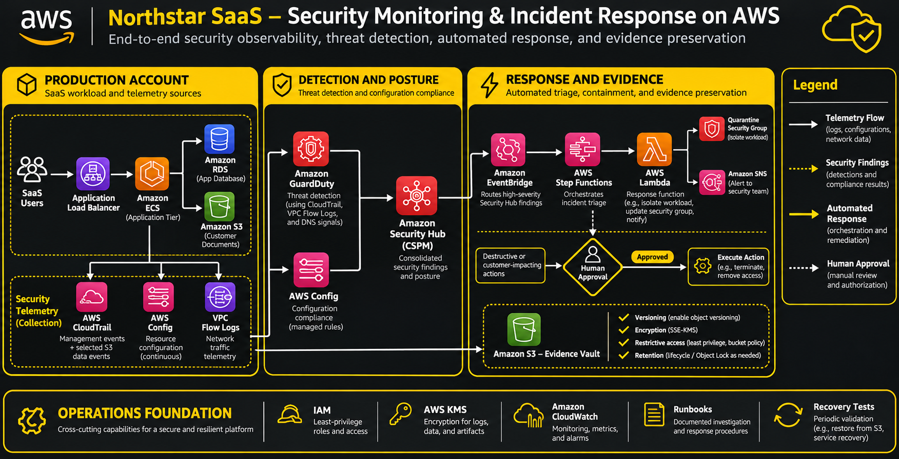

# AWS Security Monitoring and Incident Response Architecture

> **Reference project:** Northstar SaaS  
> **Cloud provider:** Amazon Web Services (AWS)  
> **Focus:** Security observability, threat detection, configuration compliance, incident response, and evidence preservation.

## 1\. Introduction

Cloud infrastructure changes continuously. Applications create resources, administrators modify permissions, workloads communicate with external services, and users access stored data. Without centralized visibility, suspicious activity can remain undetected.

This tutorial presents an independently designed security monitoring and incident response architecture for a fictional SaaS company called **Northstar**.

The platform uses AWS-native services to collect security telemetry, detect threats, evaluate resource configurations, coordinate incident response, and preserve forensic evidence.

### Learning objectives

By completing this tutorial, you should understand how to:

- Collect and analyze AWS API activity.
- Monitor resource configuration compliance.
- Detect suspicious account and workload behavior.
- Centralize security findings.
- Automate incident triage and containment.
- Preserve investigation evidence.
- Apply least-privilege access and encryption.
- Validate security controls through testing.

## 2\. Prerequisites

Recommended knowledge:

- AWS IAM fundamentals
- VPCs, security groups, and networking
- Amazon S3 and EC2
- CloudWatch and CloudTrail
- Python fundamentals
- Basic event-driven architecture

Recommended tools:

- AWS Management Console or AWS CLI
- Python 3.11+
- Boto3
- AWS CDK or CloudFormation
- Git and GitHub

Use a dedicated development account. Avoid experimenting with security automation in production.

## 3\. Reference architecture

### Business scenario

Northstar operates a SaaS application hosted on AWS. It stores customer documents in Amazon S3 and application records in Amazon RDS.

The security team needs to detect:

1. Suspicious API activity.
2. Unexpected changes to cloud resources.
3. Potentially compromised compute workloads.
4. Unauthorized access to customer data.
5. Misconfigured storage and network controls.

### Architecture components

| Component | Responsibility |
| --- | --- |
| AWS CloudTrail | Records account API activity |
| AWS Config | Tracks resource configurations and evaluates compliance |
| VPC Flow Logs | Captures network traffic metadata |
| Amazon GuardDuty | Detects suspicious and potentially malicious activity |
| AWS Security Hub CSPM | Consolidates security posture findings |
| Amazon EventBridge | Routes security events |
| AWS Step Functions | Coordinates incident workflows |
| AWS Lambda | Executes approved response operations |
| Amazon SNS | Sends security notifications |
| Amazon S3 | Stores investigation evidence |
| AWS KMS | Provides encryption key management |
| IAM | Controls service and operator permissions |
| Amazon CloudWatch | Provides operational monitoring and alarms |

### Architecture Diagram




**Important:** Automated containment should be risk-based. Actions that could disrupt customer workloads, terminate resources, or destroy data should require human approval.

## 4\. Core technical concepts

### 4.1 AWS CloudTrail: API activity auditing

CloudTrail records activity performed through AWS management interfaces, SDKs, and APIs.

A CloudTrail event can provide information about:

- The API operation.
- The identity making the request.
- The event timestamp.
- The source IP address.
- The affected AWS resource.
- The request and response context, where available.

CloudTrail distinguishes between:

**Management events:** Operations that manage AWS resources, such as creating an instance or changing a security policy.

**Data events:** Operations performed on or within resources, such as accessing an S3 object. These can generate substantial event volumes and should be enabled according to monitoring requirements.

For centralized auditing, consider multi-Region trails, appropriate log retention, encryption, and log file integrity validation.

### 4.2 AWS Config: Configuration compliance

AWS Config records supported resource configuration changes and evaluates resources against desired configuration policies.

A managed rule represents a specific compliance check.

Examples include:

- `s3-bucket-public-read-prohibited`
- `s3-bucket-public-write-prohibited`
- `rds-instance-public-access-check`
- `restricted-ssh`
- `vpc-flow-logs-enabled`

A rule evaluation can produce:

- COMPLIANT
- NON\_COMPLIANT
- INSUFFICIENT\_DATA
- NOT\_APPLICABLE

A compliance finding is not necessarily evidence of an active attack. It identifies a configuration condition that requires evaluation.

AWS Config can also use custom rules when managed rules do not cover a required policy.

### 4.3 Amazon GuardDuty: Threat detection

GuardDuty analyzes supported AWS data sources to identify suspicious or potentially malicious activity.

Detection categories include:

- Account compromise
- Instance compromise
- Reconnaissance
- Suspicious network behavior
- Potential data exfiltration
- Unusual access patterns

GuardDuty generates findings containing details such as finding type, severity, affected resources, and supporting context.

It is a detection service, not a replacement for incident investigation.

### 4.4 AWS Security Hub CSPM: Centralized security posture

Security Hub CSPM aggregates security findings from supported AWS services and integrations.

It provides a consolidated view of security posture and helps teams prioritize findings.

AWS Config evaluations can be integrated with Security Hub CSPM, allowing configuration compliance results to appear alongside other security findings.

### 4.5 Amazon EventBridge: Event routing

EventBridge provides event-driven routing between AWS services and application components.

A rule can match an event based on its source, type, and other attributes, then forward matching events to a target.

For example, a high-severity GuardDuty finding can trigger an incident workflow.

### 4.6 AWS Step Functions: Incident orchestration

Step Functions coordinates multi-stage workflows.

A security workflow might contain:

1. Receive a finding.
2. Validate its structure.
3. Enrich it with resource information.
4. Assign a severity.
5. Request human approval when necessary.
6. Execute an authorized response.
7. Notify the security team.
8. Record the outcome.

This separates orchestration logic from individual response functions.

## 5\. Original implementation examples

The following examples are illustrative building blocks. They are not a complete production deployment.

### 5.1 Define an incident record

Use a consistent internal data model to track security incidents.

``` json
{
  "incident_id": "INC-2026-0042",
  "source": "guardduty",
  "severity": "HIGH",
  "category": "suspicious-api-activity",
  "resource": {
    "type": "AWS::EC2::Instance",
    "identifier": "i-example123456"
  },
  "status": "OPEN",
  "assigned_team": "cloud-security",
  "requires_approval": true,
  "created_at": "2026-11-07T12:00:00Z"
}
```

The identifier and values above are fictional examples.

### 5.2 Process a security finding with Python

This example validates an incoming GuardDuty-style event and produces a normalized incident record.

``` python
from datetime import datetime, timezone
from uuid import uuid4


def normalize_finding(event: dict) -> dict:
    detail = event.get("detail", {})

    if not detail:
        raise ValueError("Missing finding details")

    severity_score = detail.get("severity", {}).get("score", 0)

    if severity_score >= 7:
        severity = "HIGH"
    elif severity_score >= 4:
        severity = "MEDIUM"
    else:
        severity = "LOW"

    resource = (
        detail.get("resource", {})
        .get("instanceDetails", {})
    )

    return {
        "incident_id": f"INC-{uuid4().hex[:12]}",
        "source": "guardduty",
        "finding_type": detail.get("type", "UNKNOWN"),
        "severity": severity,
        "resource_id": resource.get("instanceId"),
        "status": "OPEN",
        "requires_approval": severity == "HIGH",
        "created_at": datetime.now(
            timezone.utc
        ).isoformat()
    }
```

This function only normalizes data. It does not isolate instances, revoke credentials, or modify infrastructure.

In production, validate the event schema, handle missing fields, add idempotency, and log processing failures.

### 5.3 Route high-severity findings

A conceptual EventBridge pattern:

``` json
{
  "source": ["aws.guardduty"],
  "detail-type": [
    "GuardDuty Finding"
  ],
  "detail": {
    "severity": {
      "score": [
        { "numeric": [">=", 7] }
      ]
    }
  }
}
```

Configure the EventBridge target to invoke a controlled response workflow.

Verify the event pattern against actual events in the target account before deploying it.

### 5.4 Example response workflow

A Step Functions workflow can implement the following logical sequence:

``` text
Receive Finding
      |
      v
Validate Event
      |
      v
Enrich Resource Context
      |
      v
Evaluate Severity
      |
      +---- Low/Medium ----> Notify Security Team
      |
      +---- High ----------> Request Approval
                                  |
                           +------+------+
                           |             |
                        Approved      Rejected
                           |             |
                     Containment     Record Decision
                           |
                     Preserve Evidence
                           |
                     Notify Team
```

The workflow should include timeouts, retries, failure handling, and a clear record of every action.

### 5.5 Evidence preservation

Investigation artifacts may include:

- Relevant CloudTrail events.
- GuardDuty findings.
- Resource configuration snapshots.
- Network flow records.
- Incident timelines.
- Approved response actions.

Store evidence in a dedicated S3 location with:

- Restricted IAM access.
- Encryption at rest.
- Versioning.
- Lifecycle policies.
- Object Lock where immutable retention is required.

Object Lock should be configured according to the organization's retention and legal requirements. It is not a substitute for access control.

## 6\. Security and reliability

### Identity and access management

Apply least privilege to every service role.

For example:

- A finding processor should read only the event data it requires.
- A notification function should publish only to its designated SNS topic.
- A containment function should modify only explicitly authorized resources.
- Human operators should use separate investigation and approval permissions.

Avoid broad managed policies and long-lived access keys where possible.

### Network security

Use private subnets for application workloads where appropriate.

Restrict security group ingress and egress to required communication paths.

Enable VPC Flow Logs for network visibility, and use network segmentation to reduce lateral movement.

### Data protection

Use encryption in transit and at rest.

Apply restrictive S3 bucket policies and account-level public access controls.

Separate production data from forensic evidence. Avoid giving application workloads write access to evidence repositories.

### Reliability

Build for partial failure:

- Configure EventBridge retries and dead-letter handling where supported.
- Make Lambda processing idempotent.
- Add workflow timeouts.
- Record failed actions.
- Alert on repeated processing failures.
- Test recovery and evidence restoration procedures.

### Human approval

Use approval gates for destructive or high-impact operations.

A security automation system should not automatically terminate a production workload solely because a single detection signal was received.

## 7\. Testing and troubleshooting

### Validation strategy

| Test | Expected outcome |
| --- | --- |
| Generate a controlled API activity event | CloudTrail records the event |
| Modify a test resource configuration | AWS Config records the change |
| Introduce a controlled non-compliant test configuration | Config identifies the violation |
| Send a sample finding to the event processor | A normalized incident is created |
| Match a test event against an EventBridge rule | The configured target is invoked |
| Execute the workflow with approval denied | No containment action is performed |
| Execute the workflow with approval granted | Only the authorized action runs |
| Review the evidence repository | Expected artifacts are retained and accessible to authorized users |

Use non-production resources and approved test procedures.

### Common issues

**No AWS Config evaluations**

Check that the recorder is active, the relevant resource types are recorded, and the rules are enabled.

**No GuardDuty findings**

GuardDuty findings depend on detected activity. Enabling the service does not guarantee immediate findings. Use supported sample findings for controlled integration testing.

**EventBridge rule does not invoke its target**

Check the event pattern, target configuration, resource permissions, and failed invocation metrics.

**Lambda function fails**

Inspect CloudWatch logs, execution role permissions, timeout settings, and input validation.

**Evidence is missing**

Check the destination bucket, encryption permissions, bucket policy, delivery configuration, and lifecycle settings.

## 8\. Cost and performance considerations

Security monitoring introduces costs that should be evaluated before deployment.

| Service | Cost consideration |
| --- | --- |
| CloudTrail | Management events and additional data event logging |
| AWS Config | Recorded configuration items and rule evaluations |
| GuardDuty | Analyzed data sources and enabled protection plans |
| Security Hub CSPM | Enabled security standards and checks |
| EventBridge | Events processed and delivered |
| Step Functions | State transitions or workflow execution model |
| Lambda | Invocations, duration, and allocated compute |
| S3 | Storage, requests, retrieval, and retention |
| CloudWatch | Log ingestion, storage, metrics, and alarms |

Optimization practices:

- Enable high-volume data event logging selectively based on risk.
- Use S3 lifecycle policies for evidence retention.
- Avoid duplicate event processing.
- Filter unnecessary events before invoking expensive workflows.
- Monitor Lambda duration and Step Functions execution counts.
- Review AWS Budgets and cost allocation tags.

Do not reduce critical audit coverage merely to lower costs. Establish security requirements first, then optimize implementation.

## 9\. Official documentation

Use official AWS documentation as the authoritative source for service behavior, supported configurations, and current pricing.

| Topic | Documentation |
| --- | --- |
| AWS CloudTrail | https://docs.aws.amazon.com/awscloudtrail/latest/userguide/cloudtrail-user-guide.html |
| AWS Config | https://docs.aws.amazon.com/config/latest/developerguide/WhatIsConfig.html |
| AWS Config managed rules | https://docs.aws.amazon.com/config/latest/developerguide/managed-rules-by-aws-config.html |
| Amazon GuardDuty | https://docs.aws.amazon.com/guardduty/latest/ug/what-is-guardduty.html |
| AWS Security Hub CSPM | https://docs.aws.amazon.com/securityhub/latest/userguide/what-is-securityhub.html |
| Amazon EventBridge | https://docs.aws.amazon.com/eventbridge/latest/userguide/eb-what-is.html |
| AWS Step Functions | https://docs.aws.amazon.com/step-functions/latest/dg/welcome.html |
| AWS Lambda | https://docs.aws.amazon.com/lambda/latest/dg/welcome.html |
| Amazon S3 security | https://docs.aws.amazon.com/AmazonS3/latest/userguide/security-best-practices.html |
| AWS Well-Architected Security Pillar | https://docs.aws.amazon.com/wellarchitected/latest/security-pillar/welcome.html |
| AWS Security Incident Response | https://docs.aws.amazon.com/security-ir/latest/userguide/what-is.html |

## 10\. Conclusion

A mature cloud security architecture combines preventive controls, continuous monitoring, threat detection, automated orchestration, and evidence preservation.

The key engineering principle is separation of responsibilities:

- CloudTrail provides audit visibility.
- AWS Config evaluates configuration compliance.
- GuardDuty detects suspicious activity.
- Security Hub CSPM centralizes security posture.
- EventBridge routes relevant events.
- Step Functions coordinates response workflows.
- Lambda performs controlled operations.
- S3 preserves investigation evidence.

Automation improves response speed, but it must operate within explicit authorization boundaries. Human approval, auditable actions, least-privilege permissions, and recovery testing remain essential.

**The result is a security architecture that is observable, testable, recoverable, and designed to scale with the application.**

**Disclaimer:** This is an independently designed educational reference architecture, not a production deployment blueprint or a guarantee of copyright or licensing compliance.
