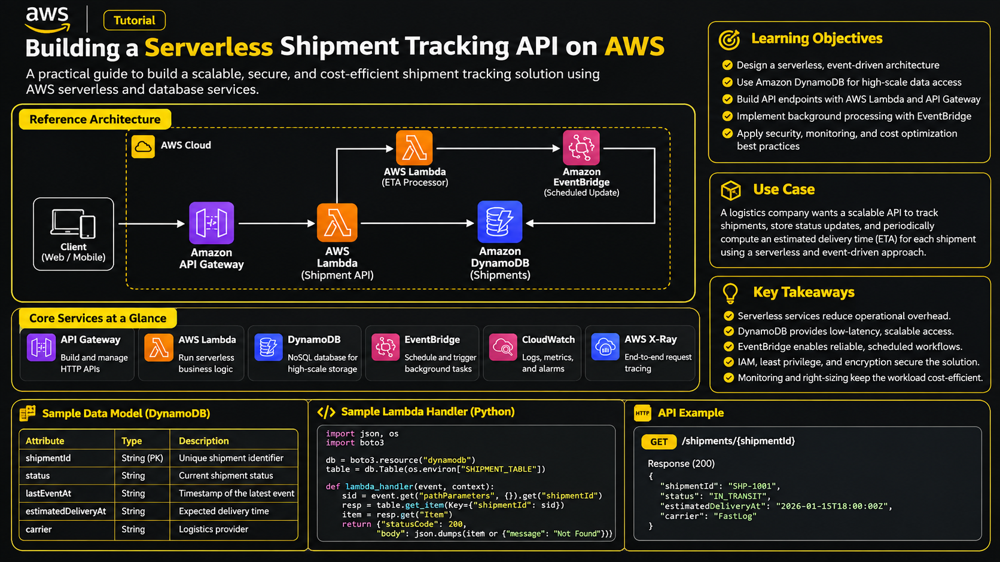

# Building a Serverless Cold-Chain Monitoring Platform on AWS

> An independently designed learning project demonstrating IoT ingestion, event-driven processing, durable exception handling, time-series storage, analytics, security, and operational observability. This tutorial is a standalone educational design and is not a reproduction of any certification lab.

## 1. Introduction

Cold-chain operators need to know whether temperature-sensitive goods remain within approved environmental limits while moving through warehouses and vehicles. This reference project collects telemetry from sensor devices, detects excursions, preserves raw observations, and gives operations teams a searchable history.

The design deliberately uses an IoT telemetry and compliance use case rather than a customer shipment lookup workflow. It emphasizes streaming ingestion, time-series analysis, and operational alerting.

### Learning objectives

- Design a scalable ingestion path for device telemetry.
- Validate and normalize events with AWS Lambda.
- Persist time-series observations and raw evidence.
- Route threshold violations asynchronously.
- Make processing resilient with retries, idempotency, and dead-letter queues.
- Secure device and service identities using least privilege.
- Observe latency, failures, and throughput, and control operating costs.

## 2. Prerequisites

- An AWS account in a non-production sandbox.
- AWS CLI v2 configured with a least-privilege deployment identity.
- Python 3.12 and `boto3` for local examples.
- Familiarity with IAM, JSON, and basic event-driven design.
- A budget alert and a cleanup plan before deploying resources.

Do not commit access keys, device certificates, customer information, or account-specific identifiers to source control.

## 3. Independently designed reference architecture

### System overview

1. Temperature sensors publish telemetry to **AWS IoT Core** using MQTT with device certificates.
2. An IoT Rule forwards accepted messages to **Amazon Kinesis Data Streams**.
3. A stream consumer Lambda validates payloads, rejects malformed readings, and writes normalized measurements to **Amazon Timestream**.
4. The consumer also stores immutable raw event objects in **Amazon S3** for audit and replay.
5. When a reading exceeds a configured operating envelope, the consumer publishes a domain event to **Amazon EventBridge**.
6. An EventBridge rule routes excursion events to **Amazon SQS**. A queue redrive policy sends repeatedly failing messages to a dedicated DLQ.
7. A notification worker Lambda consumes the queue and starts an **AWS Step Functions** workflow. The workflow records an incident, sends an alert through **Amazon SNS**, and can wait for an operator acknowledgement.
8. **Amazon CloudWatch** collects logs, metrics, and alarms. **AWS X-Ray** traces supported service calls. **AWS Glue and Amazon Athena** can query the S3 evidence lake for investigations.

### Architecture diagram




The diagram is an original logical design. It is not a deployment template: networking, encryption keys, retention settings, service quotas, and IAM policies must be defined for the target environment.

## 4. Core technical concepts

### 4.1 Device identity and ingestion

Use a unique X.509 certificate and IoT policy for each device or managed device group. Restrict each identity to publishing only to its assigned topic namespace. Rotate and revoke credentials through a documented device lifecycle.

MQTT is suitable for constrained devices and intermittent connectivity. Kinesis Data Streams provides a durable stream buffer that decouples device ingestion from downstream processing. Choose partition keys that distribute load while preserving ordering for a device where needed—for example, a stable hash of `deviceId`.

### 4.2 Event envelope and data model

Use a versioned event envelope so producers and consumers can evolve independently.

Example telemetry event:

```json
{
  "schemaVersion": 1,
  "eventId": "evt-7f31c2",
  "deviceId": "sensor-north-014",
  "assetId": "container-208",
  "observedAt": "2026-02-18T09:42:11Z",
  "temperatureC": 7.8,
  "humidityPct": 61.2,
  "location": {
    "siteCode": "BLR-HUB-02",
    "zone": "cold-room-b"
  }
}
```

Suggested logical records:

| Entity | Key fields | Purpose |
|---|---|---|
| Telemetry measurement | `time`, `deviceId`, dimensions | Time-series queries in Timestream |
| Raw evidence object | `eventId`, ingestion date | Immutable source record in S3 |
| Excursion incident | `incidentId`, `assetId`, status, openedAt | Workflow and operator lifecycle |
| Device registry | `deviceId`, certificate status, assetId | Device inventory and ownership |

Use UTC timestamps. Distinguish device-observed time from cloud-ingestion time; the difference helps identify clock drift and network delay.

### 4.3 Validation and idempotency

A stream consumer should validate required fields, enforce sensible numeric ranges, normalize timestamps, and attach an ingestion timestamp. Treat `eventId` as an idempotency key. A retry must not create duplicate incidents or duplicate notifications.

For high-throughput processing, batch writes where supported and handle partial failures explicitly. Do not silently discard malformed records: route them to a quarantine location with a reason code and minimal sensitive context.

### 4.4 Threshold evaluation

Keep operating limits in configuration rather than hard-coding them into the handler. Real cold-chain limits vary by product and regulatory context; this tutorial does not prescribe a universal safe temperature.

Avoid alert storms by applying hysteresis, minimum excursion duration, deduplication windows, and incident state transitions. For example, open one incident when a device crosses its configured upper limit, then resolve it only after a configured recovery condition is met.

## 5. Implementation examples

The following snippets illustrate core logic. They are educational fragments, not a complete deployable application. Add schema validation, structured logging, IAM, tests, and infrastructure definitions before deployment.

### 5.1 Validate a telemetry event

```python
from datetime import datetime, timezone
from decimal import Decimal
from uuid import uuid4

REQUIRED = {
    "eventId", "deviceId", "assetId",
    "observedAt", "temperatureC"
}

def normalize_event(payload: dict) -> dict:
    missing = REQUIRED - payload.keys()
    if missing:
        raise ValueError(f"missing required fields: {sorted(missing)}")

    observed_at = datetime.fromisoformat(
        payload["observedAt"].replace("Z", "+00:00")
    )
    if observed_at.tzinfo is None:
        raise ValueError("observedAt must include a timezone")

    temperature = Decimal(str(payload["temperatureC"]))
    if not temperature.is_finite():
        raise ValueError("temperatureC must be finite")

    return {
        **payload,
        "temperatureC": temperature,
        "observedAt": observed_at.astimezone(timezone.utc).isoformat(),
        "ingestedAt": datetime.now(timezone.utc).isoformat(),
        "processingId": str(uuid4())
    }
```

### 5.2 Publish an excursion event

```python
import json
import boto3
from datetime import datetime, timezone

events = boto3.client("events")

def publish_excursion(reading: dict, rule_name: str) -> None:
    detail = {
        "eventId": reading["eventId"],
        "deviceId": reading["deviceId"],
        "assetId": reading["assetId"],
        "temperatureC": str(reading["temperatureC"]),
        "observedAt": reading["observedAt"],
        "ruleName": rule_name
    }

    result = events.put_events(Entries=[{
        "Source": "example.coldchain.telemetry",
        "DetailType": "TemperatureExcursionDetected",
        "Time": datetime.now(timezone.utc),
        "EventBusName": "default",
        "Detail": json.dumps(detail)
    }])

    if result.get("FailedEntryCount", 0):
        raise RuntimeError("EventBridge rejected the excursion event")
```

In production, make the bus name configurable, inspect per-entry errors, and use a durable retry strategy. A successful API response does not mean downstream processing has completed.

### 5.3 Idempotent incident creation

A common pattern is a conditional write keyed by a deterministic incident identifier. The exact key strategy depends on whether the business wants one incident per reading, per device and excursion episode, or per asset and rule.

```python
import hashlib

def incident_key(device_id: str, rule_name: str, episode_start: str) -> str:
    raw = f"{device_id}|{rule_name}|{episode_start}"
    return hashlib.sha256(raw.encode("utf-8")).hexdigest()
```

Use a DynamoDB conditional expression such as `attribute_not_exists(incidentId)` when creating an incident record. Treat a conditional-check failure as a duplicate, not as an unhandled application failure.

### 5.4 Example queue consumer behavior

A queue-triggered Lambda should process each record independently where possible. Configure the event source mapping for partial batch responses so successful records are not retried just because a different record in the batch failed. Set the queue visibility timeout to exceed the function timeout with an appropriate safety margin.

## 6. Security and reliability

### Identity and access management

- Give each Lambda function a dedicated execution role.
- Scope S3 writes to the required bucket and prefix.
- Scope Timestream permissions to the intended database and table.
- Restrict EventBridge publishing to the required event bus.
- Restrict queue consumption to the relevant queue.
- Avoid wildcard actions and resources unless a service explicitly requires them.
- Separate deployment permissions from runtime permissions.

### Encryption and data protection

- Use TLS for device-to-cloud communication.
- Enable encryption at rest for streams, queues, databases, and object storage where supported.
- Use AWS KMS customer-managed keys when key separation, audit, or rotation requirements justify the operational overhead.
- Apply S3 Block Public Access, bucket policies, versioning, and lifecycle retention controls.
- Avoid placing secrets in Lambda environment variables; use AWS Secrets Manager or Systems Manager Parameter Store where appropriate.

### Resilience

- Configure retries and a DLQ for asynchronous queue processing.
- Alarm on DLQ depth, iterator age, throttles, and failed invocations.
- Use bounded retries with backoff for transient downstream errors.
- Apply idempotency to all operations that may be retried.
- Define replay procedures for quarantined events and archived source records.
- Test recovery from service throttling and temporary downstream unavailability.

## 7. Testing and troubleshooting

### Unit tests

Test at least:

- Missing required attributes.
- Invalid timestamps and timezone-naive timestamps.
- Non-numeric, infinite, or out-of-range sensor readings.
- Duplicate event identifiers.
- Readings inside and outside configured thresholds.
- EventBridge partial failures.
- Duplicate incident creation.
- Queue retries and poison-message handling.

Example threshold test:

```python
def is_excursion(value: float, lower: float, upper: float) -> bool:
    return value < lower or value > upper

def test_excursion_boundaries():
    assert not is_excursion(5.0, 2.0, 8.0)
    assert is_excursion(8.1, 2.0, 8.0)
    assert is_excursion(1.9, 2.0, 8.0)
```

### Operational troubleshooting guide

| Symptom | Likely causes | Investigation |
|---|---|---|
| No telemetry reaches processing | IoT topic policy, rule target, stream ARN, or region mismatch | Inspect IoT Rule metrics and Kinesis incoming records |
| Stream lag increases | Consumer throttling, slow writes, hot partition | Review iterator age, Lambda duration, and shard distribution |
| Duplicate incidents | Missing idempotency or unstable incident key | Compare event IDs and conditional-write outcomes |
| Queue depth grows | Worker errors, insufficient concurrency, downstream throttling | Inspect queue age, Lambda errors, and DLQ |
| Raw evidence is missing | S3 permission, key policy, or failed object write | Inspect structured logs and S3 data events |
| Alerts are not delivered | SNS subscription state or workflow failure | Inspect Step Functions execution history and SNS delivery metrics |

Use structured logs with `eventId`, `deviceId`, and a correlation identifier. Do not log credentials, certificates, or unnecessary personal information.

## 8. Cost and performance considerations

- Select Kinesis shard capacity or on-demand mode based on traffic patterns and burst requirements.
- Batch stream records and database writes while keeping latency within the operational target.
- Set retention periods deliberately for Kinesis, Timestream, and S3.
- Use S3 lifecycle policies to transition older evidence to lower-cost storage classes where retrieval needs permit.
- Use Timestream retention tiers to balance recent operational queries and historical analysis.
- Set Lambda memory based on measured duration and cost, not guesswork.
- Bound concurrency to protect downstream databases and third-party integrations.
- Configure CloudWatch log retention; avoid indefinite retention by default.
- Create AWS Budgets alerts and review Cost Explorer by service and environment.
- Load-test realistic peak rates and validate throttling, recovery, and cost before production.

## 9. Official documentation

- [AWS IoT Core](https://docs.aws.amazon.com/iot/latest/developerguide/what-is-aws-iot.html)
- [AWS IoT Rules](https://docs.aws.amazon.com/iot/latest/developerguide/iot-rules.html)
- [Amazon Kinesis Data Streams](https://docs.aws.amazon.com/streams/latest/dev/introduction.html)
- [AWS Lambda](https://docs.aws.amazon.com/lambda/latest/dg/welcome.html)
- [Amazon Timestream for LiveAnalytics](https://docs.aws.amazon.com/timestream/latest/developerguide/what-is-timestream.html)
- [Amazon EventBridge](https://docs.aws.amazon.com/eventbridge/latest/userguide/eb-what-is.html)
- [Amazon SQS dead-letter queues](https://docs.aws.amazon.com/AWSSimpleQueueService/latest/SQSDeveloperGuide/sqs-dead-letter-queues.html)
- [AWS Step Functions](https://docs.aws.amazon.com/step-functions/latest/dg/welcome.html)
- [Amazon SNS](https://docs.aws.amazon.com/sns/latest/dg/welcome.html)
- [Amazon S3 security best practices](https://docs.aws.amazon.com/AmazonS3/latest/userguide/security-best-practices.html)
- [AWS X-Ray](https://docs.aws.amazon.com/xray/latest/devguide/aws-xray.html)
- [AWS Well-Architected Framework](https://docs.aws.amazon.com/wellarchitected/latest/framework/welcome.html)

Check the current service documentation for regional availability, quotas, pricing, and feature changes before implementation.

## 10. Conclusion

This project demonstrates how a serverless telemetry platform can ingest device data, preserve evidence, detect operational exceptions, and coordinate response workflows without tightly coupling producers to consumers.

The most important engineering decisions are not the number of AWS services used. They are the correctness of event contracts, idempotent processing, least-privilege access, deliberate retention, failure isolation, and measurable operational objectives. Start with a small end-to-end slice, test failure paths, and expand only when metrics justify the added complexity.

**Disclaimer:** This is an independently designed educational reference architecture, not a production deployment blueprint or a guarantee of copyright or licensing compliance.


---
